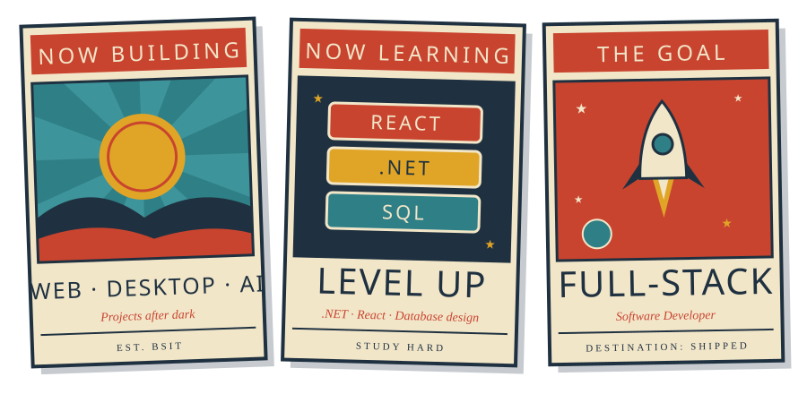

 

  

 
Kirkt is a BSIT student building web applications, desktop software, databases and AI projects.
Every line of code is practice for one goal: becoming a full-stack software developer.
 

 

 

 

 

  

 

  

  

  

 

  

